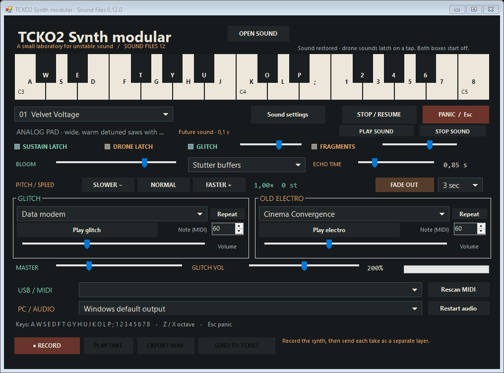

# TCKO2 Synth modular

A small experimental Windows synthesizer for warm analogue-style tones, expansive drones and strange metallic textures. Play from an Akai MPK mini Play mk3, another USB MIDI keyboard, your computer keyboard, or the on-screen keys.



## Download and play

**v0.12.0:** **Open sound** is beside the title. It starts in your Projects/TCK02/SOUNDS folder, which can stay empty until you add recordings. WAV, M4A/AAC, MP3 and MP4 audio decode locally. Play sound and Stop sound control the imported file; master volume and global transport also apply. REC captures the combined file and synth performance. The synth keyboard/effect controls shape generated voices; the imported file plays its original audio alongside them.

The upper selector has eleven original sounds. All eight additional sounds remain in **Old Electro**. The browser counterpart is available on [Project Stories](https://project-stories-eta.vercel.app/tcko2.html), with the same header control and grouping. Browser format support depends on its decoders.


Download the **Windows x64 portable ZIP** from [Releases](https://github.com/TiagoCalvados/tcko2-synth-modular/releases), extract it, and double-click **TCKO2Synth.exe**. No account, DAW, plug-ins or large software installation is required. Requires 64-bit Windows and .NET Framework 4.x; .NET Framework is already included on many Windows PCs.

Connect the Akai over USB and turn **Internal Sounds** off. The synth's audio comes from the **PC's speakers/headphones or audio interface**. For a mixer: Akai USB → PC → PC audio output → mixer LINE input → speakers. The Akai headphone output carries its own internal sounds.

Start with low speaker volume. Master starts at 20%; the app opens silently. **Esc / Panic** clears notes and effect tails. **Stop / Resume** mutes the engine and ignores new notes until resumed.

## Sounds and controls

- Eleven presets: warm pads, acid bass, dusty keys, metallic bells, three dedicated drones, an organ, a gritty lead and shimmering keys.
- Eight sound macros with MIDI learn: Tone, Squelch, Drift, Grit, Tape echo, Room, Metal and Motion.
- **Sustain latch** holds released notes; **Drone latch** toggles individual held notes with repeated taps.
- **Bloom** adds two extra detuned oscillators, stereo chorus, a fuller sustain level and long release.
- **Echo Time** ranges from 0.08 to 4 seconds between repeats; Tape echo controls wet amount and feedback.
- Velocity, sustain pedal and ±2-semitone pitch bend. Eight-voice polyphony.

Click **Learn** on a dial, then turn an Akai knob. The controller has four knobs and A/B banks for eight assignments. Mappings save beside the executable. Computer keys **A W S E D F T G Y H U J K O L P ;** play chromatically; **Z / X** change octave.

Try **Lunar Array / Drone**, tap a low note and a fifth, and slowly shape Tone and Bloom. The drone presets enable their latch automatically and have 12–16 second release fades. See the [playing guide](docs/PLAYING.md) for presets, controller setup and controls.

## Building from source

Uses the .NET Framework compiler, Windows Forms, and built-in WinMM MIDI/audio APIs. No NuGet packages, network access or dotnet SDK are needed to build.

From the repository root in PowerShell:

```powershell
powershell -ExecutionPolicy Bypass -File .\build.ps1
.\bin\TCKO2Synth.exe
```

The script builds `src/TCKO2Synth.cs` into `bin/TCKO2Synth.exe`. You can also launch it using **Start TCKO2 Synth modular.cmd** after building.

## Verification

Close the normal app first; MIDI inputs may be exclusive. Create an output directory and run the built-in checks:

```powershell
New-Item -ItemType Directory -Force artifacts | Out-Null
$test = Start-Process .\bin\TCKO2Synth.exe -ArgumentList '--self-test', 'artifacts' -Wait -PassThru
$test.ExitCode
Get-Content .\artifacts\verification.txt
```

`--self-test` checks DSP output, MIDI handling, latches, presets, UI, long echo timing, stereo widening, numerical stability and native Windows audio buffer recycling. It writes a report, interface PNG and an 88-second preset preview WAV. `--core-test` excludes live MIDI input and audio output; it writes `verification-core.txt`. Use `--files-test <existing-output-folder>` for file loading, upper-selector/Old Electro grouping, common-master/recording integration and title-header checks. Neither command needs to interrupt a running instrument.

The v0.3.0 Windows build passed the full DSP, MIDI-message, UI and Windows audio test. Physical keyboard/knob response and audible playback still require a human play check on each setup. Device latency varies; wired audio is the best first test.

## Version

**v0.12.0 — experimental prototype.** See [CHANGELOG](CHANGELOG.md).
